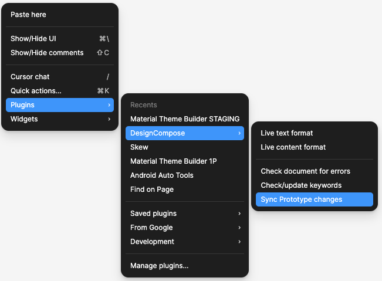

# Animations

Animations are supported in two different ways: animations from Figma interactions, and animations from programmatically changing variants.

## Figma interaction animations
Animations set in Figma as a prototype interaction are supported. These animations run automatically whenever an interaction triggers the animation to begin. After making any changes to an interaction, make sure to run the `Sync Prototype changes` plugin so that the interaction is saved to the plugin data.



### Supported Prototype Interactions {#interactions}

DesignCompose translates Figma prototyping interactions directly into Compose state and transition drivers.

#### Interaction Triggers
* **On Click / On Tap:** Triggered upon tapping or clicking an interactive element.
* **While Pressing:** Activates when a pointer/finger is held down on an element, and automatically reverts to the original state upon release (ideal for pressed buttons or highlight effects).
* **On Key Down:** Triggered by hardware or virtual key events dispatched through `DesignInjectKey`.
* **After Delay:** Automatically fires after a specified duration in milliseconds (useful for splash screen timeouts, automated walkthroughs, or pulsing animations).

#### Interaction Actions
* **Change To:** Switches between component variants within a Component Set (for example, toggling an interactive checkbox, switch, or button state).
* **Navigate To:** Navigates from one top-level screen or frame to another.
* **Open Overlay:** Displays a frame on top of the current screen with configurable positioning (Center, Top, Bottom, Manual).
* **Swap Overlay:** Replaces the currently active overlay with another frame.
* **Close Overlay:** Dismisses the top-most active overlay.
* **Back:** Traverses backwards in the navigation and overlay history stack, undoing previous navigation or overlay actions.

#### Transitions & Smart Animate
* **Instant:** Switches between states immediately without animation.
* **Dissolve / Fade:** Fades smoothly between differing node contents or opacities.
* **Smart Animate:** Matches layer names and structural hierarchy between the source and destination states. DesignCompose decomposes transformations and interpolates positions (`left`, `top`, `translateX`, `translateY`), dimensions (`width`, `height`, `scaleX`, `scaleY`), rotation angle, opacity, vector arcs, and solid-color backgrounds and strokes. Note: Arbitrary vector path geometries and gradient/image fills are cross-faded rather than morph-interpolated. Easing curves defined in Figma (Linear, Ease In, Ease Out, Ease In and Out, Custom Cubic Bezier, and Spring physics) are supported.


## Variant change animations
When variants change programmatically using the `@DesignVariant` customization, they will use a default spring animation for the transition. This can be customized using the custom animation API by specifying an easing type, duration, and delay in the `DesignDocSetting()` function. Populate the new `customVariantTransition` parameter with a function that takes a `VariantTransitionContext` and returns an `AnimationTransition` interface. The context provides some data on variant that is changing, and the `AnimationTransition` needs two functions: `animationSpec()` that returns `AnimationSpec<Float>`, and `delayMillis()` that returns an `Int` representing the number of milliseconds to wait before beginning the animation. The `SmartAnimateTransition` is the only supported transition at this time. The easiest way to use this is to use a compose function such as `androidx.compose.animation.core.tween`, and optionally, the delay time in milliseconds.

Here is an example:

```kotlin
DesignDocSettings(
    customVariantTransition = { context ->
        if (context.fromComponentSet("MyComponentName")) {
            SmartAnimateTransition(
                tween(
                    durationMillis = (2f * 1000.0).roundToInt(),
                    easing = CubicBezierEasing(0.37f, 0f, 0.63f, 1f)
                )
            )
        } else {
            val mass = 1.0f
            val stiffness = 20.0f
            val critical = sqrt(4.0f * stiffness * mass)
            val damping = 30.0f
            SmartAnimateTransition(
                spring(dampingRatio = damping / critical, stiffness = stiffness),
                1000 // Delay by 1 second
            )
        }   

    }
)
```
<div class="warning" style='padding:0.1em; background-color:#FFF0B2; color:#000000; border:1px solid black; box-shadow: 5px 6px grey;'>
<span>
<p style='margin-left:1em;'>
We’re still working on the best way to identify the elements that are being animated. We added functions in <b>VariantTransitionContext</b> that use the node or component name, but this may change in the future.
</p>
</span>
</div>